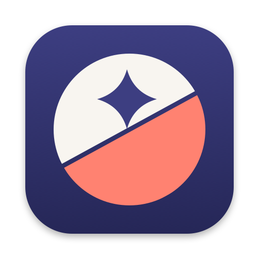
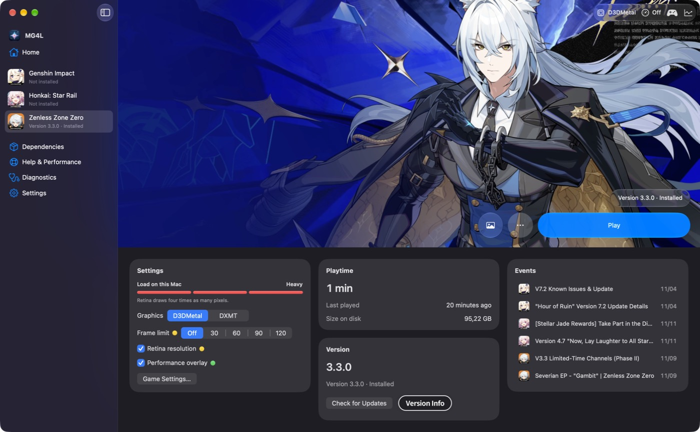
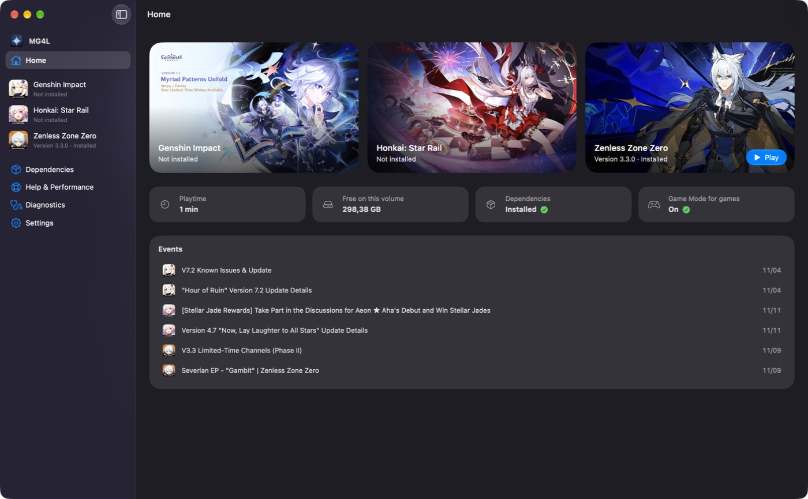

<p align="center"></p>
<h1 align="center">MacGacha4Life</h1>
<p align="center">Играйте в Genshin Impact, Honkai: Star Rail и Zenless Zone Zero на Mac.<br>Нативный лаунчер Liquid Glass для Apple Silicon.</p>

[](../README.md)
[](README.ru.md)
[](README.uk.md)
[](README.de.md)
[](README.fr.md)
[](README.zh-CN.md)
[](README.ja.md)
[](README.vi.md)





> Основан на [MacGacha](https://github.com/deruta74/MacGacha) от [deruta74](https://github.com/deruta74): движок лаунчера принадлежит им. Поддержите [оригинальный проект](https://github.com/deruta74/MacGacha).

## Возможности

- **Главная.** Каждая игра — карточка с запуском в одно нажатие, время в игре, свободное место и свежие события HoYoPlay.
- **Страница игры.** Арт на всю ширину, стеклянная панель действий и карточки: графика, ограничение кадров, оверлей производительности, время в игре и размер на диске.
- **Всё под контролем.** Установка, обновления, проверка и озвучка с официальных серверов HoYoverse, а также Wine, DXMT и D3DMetal. Загрузки можно ставить на паузу.
- **Помощь и производительность.** Поиск проблем игры в интернете, известные проблемы, отчёт об ошибке с данными о системе и чек-лист настроек, влияющих на скорость.
- **Quick Play в строке меню.** Пока игра запущена, лаунчер показывает статичные изображения и не отнимает у неё GPU.
- **Дополнительно (по желанию).** Оверлей Metal, разблокировка частоты кадров Genshin и объёмный звук. По умолчанию выключено.

## Установка

1. Скачайте `MacGacha-<версия>.dmg` на странице [Releases](https://github.com/silent9669/MacGacha4Life/releases/latest), откройте его и перетащите **MacGacha** в **Программы**.
2. Откройте приложение. macOS сообщит, что не может проверить разработчика: MacGacha не нотаризован Apple. Нажмите **Готово**, откройте **Системные настройки → Конфиденциальность и безопасность** и нажмите **Всё равно открыть**.
3. Всё ещё блокируется? Выполните в Терминале и откройте приложение снова:

```bash
xattr -dr com.apple.quarantine /Applications/MacGacha.app
```

Нужен Mac с Apple Silicon и macOS 27 или новее. Если Rosetta 2 нет, её предложат установить при первом запуске. Обновления приходят через **Проверить обновления…** в меню приложения.

## Помощь

Нашли ошибку или есть идея? [Создайте issue](https://github.com/silent9669/MacGacha4Life/issues). При проблемах с установкой или запуском приложите диагностический архив: **Диагностика** в боковой панели → **Экспортировать диагностику…**. Пути и токены из него удаляются.

## Это безопасно?

Используйте на свой риск. Чтобы игры запускались в Wine, MacGacha применяет обходные решения для античита от сообщества (jadeite, прослойка Steam). Они могут противоречить условиям использования HoYoverse, поэтому блокировка аккаунта возможна. Если опасаетесь, сначала попробуйте новый бесплатный аккаунт. Функции, меняющие процесс игры, например разблокировка частоты кадров Genshin Impact, по умолчанию выключены и предупреждают о риске перед включением. MacGacha загружает игры только с официальных серверов HoYoverse, проверяет каждый файл и никогда не просит пароль.

MacGacha4Life — неофициальный проект, не связанный с HoYoverse (COGNOSPHERE) и Apple Inc. Названия игр и товарные знаки принадлежат их владельцам. Код и документация могут создаваться с помощью ИИ-агентов. Программа предоставляется «как есть», без гарантий.

## Благодарности

[deruta74/MacGacha](https://github.com/deruta74/MacGacha) ❤️ · [Wine](https://www.winehq.org) и CodeWeavers · [DXMT](https://github.com/3Shain/dxmt) (3Shain) · [jadeite](https://codeberg.org/mkrsym1/jadeite) (mkrsym1) · [genshin-fps-unlock](https://github.com/34736384/genshin-fps-unlock) (34736384, MIT): его метод использует разблокировка частоты кадров · Proton от Valve — источник прослойки Steam · dbc-hbin за сборки Wine 11.20 + D3DMetal · an-anime-team и Michael Nelson за исправление сбоя в материковом Китае · Apple за D3DMetal и Game Porting Toolkit на условиях Apple, которые приложение просит принять.

## Лицензия

Copyright (C) 2026 deruta74 и silent9669. Свободное ПО по [GNU General Public License v3.0](../LICENSE) с одним дополнительным условием по разделу 7(b) (см. [NOTICE](../NOTICE)): каждая распространяемая копия и каждое производное от MacGacha произведение должны сохранять ссылку на https://github.com/deruta74/MacGacha в исходном коде и на экране «О программе». Любая распространяемая версия остаётся под GPL-3.0 с доступными исходниками. Компоненты, которые приложение загружает при работе, и сами игры имеют свои лицензии.
